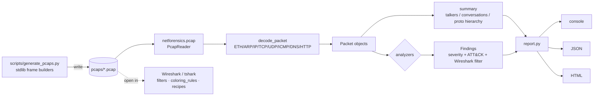

# Wireshark Network Forensics Toolkit

> Generate realistic attack PCAPs, analyze them with a zero-dependency packet
> parser, and work them like a SOC analyst with Wireshark filters, coloring
> rules and tshark recipes.


## Why this project exists

Packet analysis is the core of network-based detection and incident response,
but you cannot practice it safely on production traffic, and most "Wireshark
tutorials" stop at reading one packet. This toolkit builds the full loop a SOC
analyst lives in: it **fabricates** labelled attack captures, **detects** the
activity programmatically with the same logic you would apply by hand, and ships
the **Wireshark artifacts** (display filters, coloring rules, a profile, tshark
one-liners and written case notes) to confirm every finding manually. Everything
is synthetic and self-contained — no real hosts, no third-party services.

## What it demonstrates

- Reading the **libpcap** file format and decoding Ethernet / ARP / IPv4 / TCP /
  UDP / ICMP / DNS / HTTP **from raw bytes with `struct`** — no scapy, no
  dpkt, no pyshark. The analyzer has zero third-party dependencies.
- Detection engineering: turning an attack's network signature into a threshold
  with explicit false-positive controls, proven against a benign baseline.
- Statistics an analyst reads daily — protocol hierarchy, top talkers,
  conversations — reproduced from the packets.
- Translating a detection into a **Wireshark display filter** and a **tshark**
  command so a human can verify it.
- Analyst communication: per-scenario investigation write-ups with IOCs and
  response recommendations.

### Feature → framework mapping

| Capability | Security+ SY0-701 domain | MITRE ATT&CK | NIST CSF |
|------------|--------------------------|--------------|----------|
| TCP SYN port-scan detector | 2.4 Network attacks; 4.4 Monitoring | T1046 Network Service Discovery | DETECT (DE.CM) |
| ARP cache-poisoning / MITM detector | 2.4; 4.1 Secure network design | T1557.002 AiTM: ARP Cache Poisoning | DETECT (DE.CM) |
| DNS tunneling detector | 2.4; 4.4 | T1071.004 App Layer: DNS; T1048 Exfil | DETECT (DE.AE) |
| Cleartext credential finder | 1.4 Cryptographic concepts; 4.1 | T1040 Network Sniffing; T1552.001 | PROTECT (PR.DS) |
| C2 beaconing detector | 2.4; 4.4 | T1071.001 App Layer: Web Protocols | DETECT (DE.AE) |
| ICMP exfiltration detector | 2.4; 4.4 | T1048.003; T1095 Non-App Layer | DETECT (DE.CM) |
| SMB lateral-movement detector | 2.4; 4.1 | T1021.002 SMB/Windows Admin Shares | DETECT (DE.CM) |
| PCAP parser + statistics | 4.4 Packet capture & analysis | — | DETECT (DE.AE) |

## Architecture



## Quickstart

```bash
# optional: scapy is NOT required; the analyzer is pure stdlib.
pip install --break-system-packages pytest        # only to run the test suite

# 1. generate the synthetic captures (writes pcaps/*.pcap)
python scripts/generate_pcaps.py

# 2. analyze one capture
python -m netforensics analyze pcaps/port_scan.pcap

# 3. analyze everything, write JSON + HTML reports
python -m netforensics analyze pcaps/*.pcap --json reports/report.json --html reports/report.html

# 4. just the statistics (Wireshark Statistics-menu equivalent)
python -m netforensics summary pcaps/baseline.pcap

# 5. run the tests
python -m pytest -q
```

Useful flags: `--analyzer port_scan` (run one detector, repeatable),
`--min-severity high` (hide noise), `--fail-on high` (exit 1 for CI pipelines),
`-q` (suppress the console report when only writing files).

## Sample output

### `python -m netforensics analyze pcaps/port_scan.pcap`

```
==============================================================================
Capture: pcaps/port_scan.pcap
  Packets: 589   Bytes: 37284   Duration: 76.06s
  First: 2026-03-14 09:00:00 UTC   Last: 2026-03-14 09:01:16 UTC
  DNS queries: 9 (3 unique names)   ARP: 2   HTTP requests: 4
  Protocol hierarchy:
    ETH/IP/TCP                   561  ( 95.2%)
    ETH/IP/UDP/DNS                18  (  3.1%)
    ETH/IP/TCP/HTTP                4  (  0.7%)
    ETH/IP/UDP                     4  (  0.7%)
    ETH/ARP                        2  (  0.3%)
  Top talkers:
    10.10.0.20             435 pkts      24530 bytes
    10.10.1.66             385 pkts      20790 bytes
    ...
Findings (1), max severity HIGH:
  [1] HIGH     port_scan    T1046      TCP SYN scan from 10.10.1.66 (190 ports in 10s)
      10.10.1.66 sent SYN probes to 190 distinct TCP ports on 1 host(s); peak of 190
      unique ports inside a 10 second window. 185 probes were answered with RST (closed)
      and 5 with SYN/ACK (open), which is the classic half-open scan signature.
      Wireshark: ip.src == 10.10.1.66 && tcp.flags.syn == 1 && tcp.flags.ack == 0
==============================================================================
Analyzed 1 capture(s): 1 finding(s) [HIGH=1]
```

### `python -m netforensics analyze pcaps/arp_spoof.pcap` (findings)

```
Findings (2), max severity CRITICAL:
  [1] CRITICAL arp_spoof    T1557.002  IP 10.10.0.1 claimed by 2 different MAC addresses
      ARP replies for 10.10.0.1 were sent from 00:1c:73:aa:00:01, de:ad:be:ef:00:66. A single
      IP must map to one MAC on a LAN; two claimants means either an IP conflict or an attacker
      rewriting the ARP cache of victims to intercept traffic (MITM). de:ad:be:ef:00:66 issued
      25 replies versus 13 from 00:1c:73:aa:00:01.
      Wireshark: arp.src.proto_ipv4 == 10.10.0.1 && arp.opcode == 2
  [2] HIGH     arp_spoof    T1557.002  45 unsolicited ARP replies from de:ad:be:ef:00:66
      MAC de:ad:be:ef:00:66 sent 45 ARP 'is-at' replies that were not preceded by a 'who-has'
      request within 2s, claiming to be 10.10.0.1, 10.10.1.11. Unsolicited replies are how
      poisoning tools keep victim caches overwritten. It sent 50 replies total against 0 requests.
      Wireshark: arp.opcode == 2 && eth.src == de:ad:be:ef:00:66
```

### All eight captures (summary line per file)

```
arp_spoof.pcap        -> CRITICAL | IP 10.10.0.1 claimed by 2 MACs; 45 unsolicited ARP replies
baseline.pcap         -> INFO     | clean (control — no findings)
c2_beacon.pcap        -> HIGH     | Periodic beacon 10.10.1.14 -> 198.51.100.77:80 every ~30.0s
dns_tunnel.pcap       -> HIGH     | Probable DNS tunnel to exfil-example.net (60 unique subdomains)
http_credentials.pcap -> HIGH     | Cleartext HTTP Basic + form POST creds (10.10.1.13 -> 10.10.0.80)
icmp_exfil.pcap       -> HIGH     | ICMP tunnel 10.10.1.15 -> 198.51.100.77 (19,526 payload bytes)
port_scan.pcap        -> HIGH     | TCP SYN scan from 10.10.1.66 (190 ports in 10s)
smb_lateral.pcap      -> CRITICAL | SMB lateral-movement burst from 10.10.1.11 to 25 hosts
```

### `python -m pytest -q`

```
...........................                                              [100%]
27 passed in 0.30s
```

## Project layout

```
wireshark-network-forensics/
├── netforensics/              # zero-dependency analysis package
│   ├── pcap.py                # libpcap reader (both endians, usec/nsec)
│   ├── writer.py              # pcap writer + ETH/ARP/IP/TCP/UDP/ICMP/DNS builders
│   ├── parsers.py             # struct-based protocol decoders
│   ├── packets.py             # decoded-layer dataclasses
│   ├── summary.py             # talkers / conversations / protocol hierarchy
│   ├── report.py              # console + JSON + HTML rendering
│   ├── findings.py            # Finding / Severity types
│   ├── cli.py / __main__.py   # `python -m netforensics ...`
│   └── analyzers/             # one detector per attack
│       ├── portscan.py  arpspoof.py  dnstunnel.py  beacon.py
│       └── credentials.py  icmpexfil.py  smb.py
├── scripts/generate_pcaps.py  # builds all 8 synthetic captures
├── pcaps/                     # committed synthetic captures (<100 KB each)
├── wireshark/                 # display_filters.md, coloring_rules, preferences, tshark_recipes.md
├── investigations/            # analyst case notes, one per scenario
├── reports/                   # sample JSON + HTML output
├── tests/                     # pytest: parser + every detector + CLI
├── requirements.txt  LICENSE  .gitignore  README.md
```

## Detection / analysis details

Every detector is documented at the top of its module. The logic and the
false-positive controls:

- **Port scan (`portscan.py`)** — counts *distinct* destination ports a source
  sends a lone SYN to inside a sliding 10 s window; fires at ≥15 ports (HIGH at
  ≥50). RST-vs-SYN/ACK response ratio confirms half-open scanning. *FP control:*
  the window + unique-port requirement ignores a busy client hitting a few ports
  repeatedly; a backup or web server opening many ports to **one** peer over a
  long period does not pack them into a 10 s window.
- **ARP spoofing (`arpspoof.py`)** — flags any IP advertised by >1 MAC
  (CRITICAL), plus unsolicited replies (reply with no matching request within
  2 s, ≥5 → HIGH) and gratuitous-ARP bursts (≥3 → MEDIUM). *FP control:* a couple
  of gratuitous ARPs at boot/failover is normal and stays below threshold;
  solicited replies in the baseline never trip it.
- **DNS tunneling (`dnstunnel.py`)** — groups queries by registered domain and
  requires ≥10 unique subdomains of which ≥50% have a label ≥30 chars **or**
  Shannon entropy ≥3.5 bits/char. TXT/NULL types and high query rate raise
  severity. *FP control:* CDNs use long-ish names but **repeat** them and sit
  below the entropy bar; the unique-subdomain floor plus entropy keeps normal
  DNS quiet (verified on the baseline's 5 repeating names).
- **Beaconing (`beacon.py`)** — groups new connections by `src→dst:port`,
  computes the coefficient of variation (std-dev/mean) of the intervals; fires at
  ≥8 connections with CV ≤0.35 (HIGH at ≤0.15). DNS/NTP ports are excluded.
  *FP control:* human traffic has CV ≫1; excluding inherently-periodic services
  and requiring a minimum connection count avoids flagging keep-alives.
- **Credentials (`credentials.py`)** — HTTP Basic headers, password-field form
  POSTs, FTP USER/PASS and mail LOGIN verbs. Secrets are **masked** in output.
  *FP control:* it only reports when a secret value is actually present.
- **ICMP exfil (`icmpexfil.py`)** — requires ≥2 of: mean payload >64 B, ≥50%
  unique payloads, mean entropy ≥4 bits/byte, over ≥5 echo requests. *FP control:*
  a real ping is a fixed-size, repeating, low-entropy pattern and satisfies none.
- **SMB lateral movement (`smb.py`)** — counts distinct TCP/445 peers per source
  in a 60 s window (≥5 → HIGH); TREE_CONNECT to `ADMIN$`/`C$`/`IPC$` escalates to
  CRITICAL. *FP control:* normal workstations reach a couple of file servers, not
  25 peers; the baseline's SMB to one server stays well under threshold.

All thresholds are module constants, easy to tune. The **baseline capture is the
proof**: `test_baseline_is_clean` fails the build if any detector produces a
MEDIUM-or-higher finding on benign traffic, and `test_detectors_are_specific`
asserts unrelated detectors stay silent on each attack capture.

### About the PCAP engine

The brief allowed scapy for the generator if available; it is not installable in
the build environment, so **both** the generator and analyzer use a hand-written,
stdlib-only pcap writer/reader (`netforensics/writer.py`, `netforensics/pcap.py`)
with correct IP/TCP/UDP/ICMP checksums. Result: the analyzer has **no runtime
dependencies**, and the generated files open natively in Wireshark and tshark.
The reader handles both byte orders and microsecond/nanosecond timestamp magics;
pcapng is out of scope (convert with `editcap -F pcap`).

## What I learned / Next steps

- Writing a pcap parser from the byte layout up made the protocol stack concrete
  in a way that `pyshark` never would — endianness, the IPv4 IHL field, TCP data
  offset, and DNS name-compression pointers all have to be right or nothing
  decodes.
- Detection is a trade-off dial, not a boolean. The baseline control turned
  "looks suspicious" into measurable thresholds with a regression test guarding
  them.
- **Next:** pcapng support; TLS SNI / JA3 fingerprinting for encrypted-C2 triage;
  a Zeek-style connection log export; and Suricata/Snort rule generation from
  each finding so detections can move from offline triage to inline alerting.

---

**JP Scirica** — CompTIA Security+ | linkedin.com/in/jp-scirica
